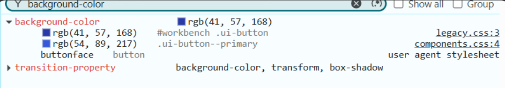
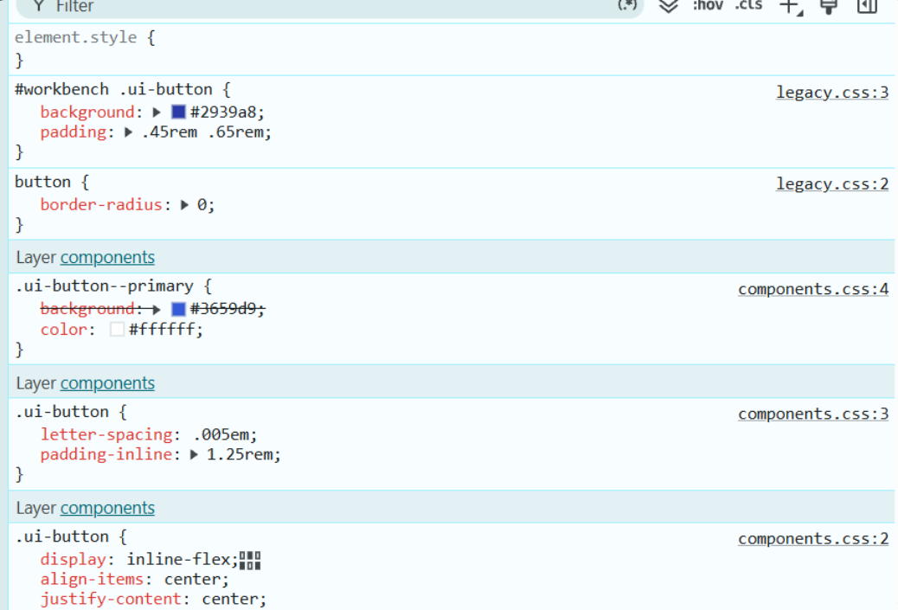
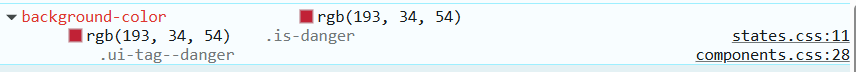
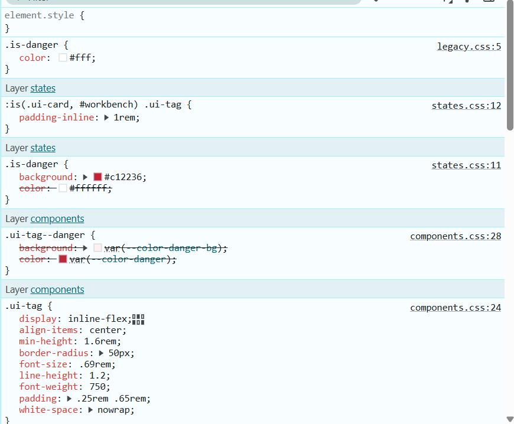
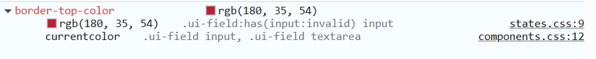
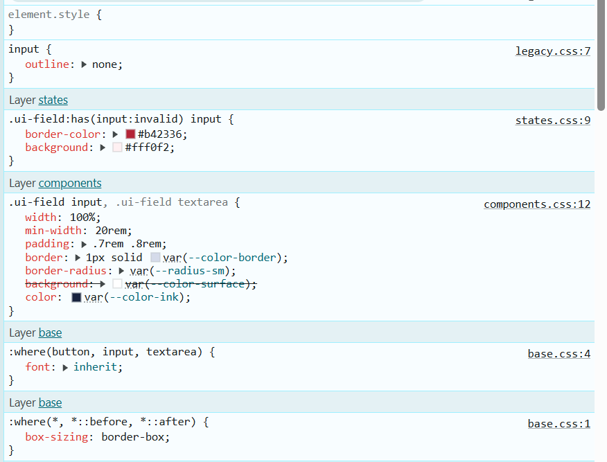

# 01. Аудит CSS-архитектуры

Автор / группа: Донченко Дмитрий Антонович 2024-ФГиИБ-ИС-2б · Репозиторий: https://github.com/DimdonTM/CampusFlow

## Гипотеза о причине (до изменения кода)

Файл подрядчика был подключён без layer() и поэтому его правила лежат вне слоёв. Обычное правило вне слоёв сильнее правила в любом слое, специфичность при этом даже не сравнивается. @layer решает порядок между группами стилей. @layer не решает такие задачи, как !important (у него порядок слоёв обратный), чужие селекторы, нацеленные на классы библиотеки, логику состояний (:invalid вместо aria-invalid), ошибки в JS (show()) и семантику (display:none у чекбокса).

## Инвентаризация дефектов (минимум 12 доказанных причин)

| ID | Симптом и шаги воспроизведения | Файл:строка | Применённое правило и выигравший каскад | Первопричина | Минимальное исправление | Регрессионный тест |
|---|---|---|---|---|---|---|
| A-01 | Кнопки "Основное действие", "Вторичное" и "Тихое действие" одного синего цвета. Проверка: Inspect на кнопке, вкладка Computed, свойство background-color | `css/app.css:3` | Побеждает `#workbench .ui-button` из legacy.css. Оно не лежит ни в одном слое, а такое правило сильнее правила из любого слоя | legacy.css подключён без layer() | Подключить legacy.css в слой legacy | тест 02 |
| A-02 | Кнопки внутри стенда синие, а такие же кнопки вверху страницы нормальные. Текст на "Вторичное" почти не виден | `css/legacy.css:3` | `#workbench .ui-button` задаёт фон и отступы всем кнопкам библиотеки внутри #workbench | Стили подрядчика лезут в кнопки библиотеки через ID | Убрать это правило из legacy.css | тест 18 |
| A-03 | Кнопка "Удалить" тёмно-красная, и её цвет ничем не поменять | `css/legacy.css:4` | Побеждает правило с !important. Если просто перенести legacy в слой, этот !important станет ещё сильнее | !important в чужом файле | Убрать !important и само правило | тесты 03, 18 |
| A-04 | Кнопки, сделанные тегом button, квадратные, а кнопки-ссылки скруглённые | `css/legacy.css:2` | `button { border-radius: 0 }` без слоя сильнее, чем border-radius у `.ui-button` из слоя components | Правило подрядчика действует на все кнопки страницы | Оставить правило только внутри виджета: `.legacy-widget button` | тест 18 |
| A-05 | При переходе по Tab у полей ввода нет рамки фокуса | `css/legacy.css:7` | `input { outline: none }` без слоя сильнее общего правила фокуса из base | Подрядчик убрал рамку фокуса у всех полей | Удалить правило или оставить его только внутри виджета | тест 18 |
| A-06 | Метки "Риск" и "Отклонено" и уведомление "Ошибка" залиты красным с белым текстом | `css/states.css:11`, `css/legacy.css:5`, `index.html` | `.is-danger` лежит в слое states. Этот слой позже components, поэтому его background побеждает `.ui-tag--danger` и `.ui-alert--danger` | Один общий класс красит сразу метки, уведомления и кнопку | Убрать .is-danger из CSS и HTML, оставить модификаторы --danger | тесты 08, 17 |
| A-07 | Текст уведомления внутри карточки №03 мелкий и серый | `css/legacy.css:6`, `css/components.css:21` | `.ui-card p` меняет font-size и color у всех абзацев внутри карточки, в том числе у абзаца уведомления | Карточка стилизует не только свои элементы, но и чужие | Стилизовать только свой абзац: `.ui-card > p` | ручная проверка |
| A-08 | У всех меток слишком большие отступы по бокам: 16px вместо 10px | `css/states.css:12` | `:is(.ui-card, #workbench) .ui-tag` задаёт padding-inline и получает вес ID. Перебить его можно только другим ID | :is() с ID внутри | Удалить правило | тест 13 |
| A-09 | Метка при наведении темнеет и курсор становится рукой, хотя нажать на неё нельзя | `css/states.css:13` | `.ui-tag:hover` добавляет filter и cursor: pointer | Метке дали вид кнопки | Удалить правило | ручная проверка |
| A-10 | Поля "Имя" и "Почта" красные сразу после загрузки, хотя пользователь ещё ничего не вводил | `css/states.css:9-10` | `.ui-field:has(input:invalid) input` задаёт красный border-color. Пустое обязательное поле считается :invalid сразу | Ошибка показывается по :invalid, а не после ввода | Показывать ошибку по aria-invalid="true", его ставит JS, когда пользователь ушёл из поля | тест 09 |
| A-11 | При переходе по Tab у кнопок нет рамки фокуса | `css/states.css:6` | `.ui-button:focus { outline: none }` в слое states сильнее общего правила фокуса из base | Рамку фокуса убрали и ничем не заменили | Убрать это правило, добавить `.ui-button:focus-visible` | тест 05 |
| A-12 | До переключателей нельзя дойти клавишей Tab | `css/components.css:44` | `.ui-switch input { display: none }`. Элемент, скрытый так, не получает фокус | Чекбокс спрятан неправильно | Прятать только визуально (position: absolute, opacity: 0), а не через display: none | тесты 05, 06 |
| A-13 | На телефоне (375 и 320 px) страница прокручивается вбок | `css/components.css:12`, `css/components.css:17` | У карточки min-width 22rem (352px), у полей min-width 20rem (320px). На узком экране им не хватает места | Слишком большая минимальная ширина | Убрать min-width | тест 10 |
| A-14 | В тёмной теме кнопки не меняют цвет, а текст уведомлений почти не читается | `css/components.css:4,7,29,45`, `css/states.css:5,9,10` | Цвета записаны кодами (#3659d9, #111827), а не переменными, поэтому тёмная тема их не меняет | В компонентах нет токенов | Заменить коды цветов на переменные из tokens.css | тест 07 |
| A-15 | Окно настроек открывается внизу страницы, фон не затемняется | `js/app.js:15` | Это не CSS. Окно открывается через show(), а не через showModal() | Неверный способ открыть окно | Заменить на showModal() | тест 04 |
| A-16 | Базовые стили кнопки записаны два раза | `css/components.css:2-3` | Второе правило .ui-button меняет padding из первого | Правило продублировано | Объединить в одно правило | тест 11 |
| A-17 | Анимации работают, даже если в системе их выключили | `css/states.css:2`, `css/components.css:2`, `css/base.css:2` | Нет правила @media (prefers-reduced-motion: reduce) | Не учтена настройка пользователя | Добавить это правило и выключить в нём анимации | тест 12 |
| A-18 | Подсказка у поля "Имя" не связана с полем, программа чтения с экрана её не прочитает | `index.html:38` | Это не CSS. У поля нет атрибута aria-describedby | Ошибка в разметке | Добавить aria-describedby="name-hint" | ручная проверка |
| A-19 | Поле "Комментарий" можно растянуть шире карточки и даже за экран, появляется скролл вбок | `css/components.css:12` | У textarea по умолчанию resize: both, и при растягивании браузер ставит своё значение ширины | Не ограничено направление растягивания | `.ui-field textarea { resize: vertical; max-width: 100%; }` | ручная проверка |

## Три трассировки каскада

Для каждой: **элемент → CSS-свойство → кандидаты с происхождением/важностью/слоем/специфичностью/порядком → победившее правило**.

Как я определял победителя. Сначала смотрю, чьё это правило (браузера или сайта) и есть ли !important. Потом смотрю слой. Потом вес селектора (специфичность). И только потом, какое правило ниже в коде.

### 1. Кнопка "Основное действие" в стенде

**Свойство:** background-color.

**Кандидаты:**
- `#workbench .ui-button` из legacy.css:3. Без слоя, вес (1,1,0), цвет #2939a8.
- `.ui-button--primary` из components.css:4. Слой components, вес (0,1,0), цвет #3659d9.
- `button` из стилей браузера, цвет buttonface.

**Победило:** `#workbench .ui-button`, кнопка синяя rgb(41, 57, 168).

**Почему:** стиль браузера всегда слабее стилей сайта. А правило без слоя сильнее правила из любого слоя, поэтому `.ui-button--primary` проиграло, и до сравнения веса дело не дошло. У такой же кнопки вверху страницы цвет правильный, потому что она не внутри #workbench.

### 2. Метка "Риск" в карточке

**Свойство:** background-color.

**Кандидаты:**
- `.is-danger` из states.css:11. Слой states, вес (0,1,0), цвет #c12236.
- `.ui-tag--danger` из components.css:28. Слой components, вес (0,1,0), светло-розовый.

**Победило:** `.is-danger`, метка красная rgb(193, 34, 54).

**Почему:** вес одинаковый, но слой states объявлен позже components, поэтому он сильнее.

**Ещё два свойства у этой метки:**
- Белый текст даёт `.is-danger { color: #fff }` из legacy.css:5. Оно без слоя, поэтому сильнее всех.
- Отступ 16px даёт `:is(.ui-card, #workbench) .ui-tag` из states.css:12. Из-за #workbench у него вес ID (1,1,0).

### 3. Поле "Почта" до ввода

**Свойство:** border-top-color.

**Кандидаты:**
- `.ui-field:has(input:invalid) input` из states.css:9. Слой states, вес (0,2,2), красный #b42336.
- `.ui-field input` из components.css:12. Слой components, вес (0,1,1), серый #d5dbea. В DevTools у него написано currentcolor, потому что рамка задана одной строкой border.

**Победило:** красная рамка rgb(180, 35, 54).

**Почему:** слой states позже components. Но главная причина в другом. Пустое обязательное поле сразу считается :invalid, поэтому рамка красная ещё до ввода. Если сделать селектор сильнее, ничего не изменится. Нужно показывать ошибку по aria-invalid="true". Этот атрибут ставит JS, когда пользователь ушёл из поля или отправил форму.

## Вывод

Большинство ошибок связаны с CSS: A-01...A-09, A-11, A-13, A-14, A-16, A-17. Главная причина в том, что стили подрядчика подключены без слоя. Поэтому они сильнее всей библиотеки и лезут в чужие кнопки, поля и карточки. Ещё есть ошибки в самой библиотеке: общий класс .is-danger, коды цветов вместо переменных, большая минимальная ширина, убранная рамка фокуса.

Одна ошибка в JS, A-15: окно открывается через show(), а нужно через showModal().

Три ошибки связаны с разметкой и логикой: A-10, A-12, A-18. Ошибка поля показывается сразу, чекбокс спрятан через display: none, подсказка не связана с полем. Их нельзя исправить более сильным селектором, нужно менять условие или HTML.

@layer помогает навести порядок между файлами. Но он не отменяет !important и не исправляет ошибки в HTML и JS.
