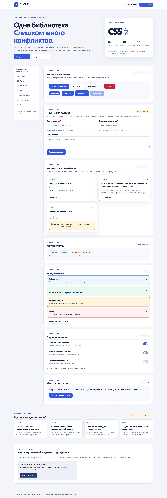

# 04. Регрессионный отчёт

## Сборка и окружение

Node: v22.19.0 · Browser/version: Chrome 158.0.8127.36

## Тестирование

- `npm test`: 18 / 18 пройдено.
- `npm run test:e2e`: не запускался, все 6 сценариев проверены вручную, они есть в матрице.
- 320 / 375 / 768 / 1024 / 1440 / 1920 px: скролла вбок нет, скриншоты лежат в screenshots/after.
- light / dark / reduced-motion / Tab / Shift+Tab / Space / Enter / Escape: всё проверено руками и работает.
- Нет глобального горизонтального скролла: да, ширина страницы равна ширине экрана на всех 6 ширинах.
- Сторонний виджет сохранён и не влияет на библиотеку: сохранён, шрифт Georgia и квадратная кнопка остались. Рамка стала сплошной, потому что стили страницы теперь сильнее. На библиотеку виджет не влияет (тест 18).

## Доказательства

| Проверка | Команда/сценарий | Результат | Скриншот/ссылка |
|---|---|---|---|
| Контраст уведомлений | Тёмная тема, сравнил цвет текста и фона уведомлений в DevTools | Было 1.57-1.87, текст почти не виден. Стало 8.56-10.9, норма от 4.5 | screenshots/after/1440-dark.png |
| Фокус переключателя | Tab до переключателя "Автосохранение", затем пробел | Tab доходит, вокруг трека оранжевая рамка, пробел переключает | npm test 05 и 06, ручная проверка |
| Действительно модальное окно | Кнопка "Настройки UI", затем несколько раз Tab и Escape | Фон затемнён, Tab не уходит из окна, Escape закрывает, фокус возвращается на кнопку | screenshots/after/dialog-open.png, npm test 04 |
| Контракт кнопки | Сравнил кнопки в стенде, в карточке и в шапке, в обеих темах | 4 варианта и 3 размера выглядят одинаково везде, цвет меняется с темой, от #workbench не зависят | screenshots/after/1440-light.png, npm test 11 и 18 |
| Длинный текст карточки | Ширина 320 px, карточка с длинным заголовком | Заголовок переносится, страница шириной 320 px, скролла вбок нет | screenshots/after/320-light.png |

## Известные ограничения

1. Playwright я не запускал. Все 6 сценариев проверил руками, они есть в матрице.
2. Если два правила лежат в одном слое, слой не поможет. Поэтому нужно следить, чтобы в селекторе был один класс.
3. Цвета и внешний вид я проверял глазами. Автоматической проверки скриншотов нет.

## До/после

**Было:** все кнопки в стенде были одного синего цвета. Правило подрядчика `#workbench .ui-button` не лежало ни в одном слое, поэтому оно было сильнее стилей кнопок.


**Что сделал:** подключил файл подрядчика в слой legacy и удалил правила, которые меняли кнопки.

**Стало:** у каждой кнопки свой цвет: primary синяя, secondary белая, danger красная.



**Главные строки из diff:**

```diff
-@import url('./legacy.css');
+@import url('./legacy.css') layer(legacy);

-#workbench .ui-button { background: #2939a8; padding: .45rem .65rem; }
-#workbench .ui-button.is-danger { background: #a41e24 !important; }
```

**Почему так лучше:** теперь стили подрядчика слабее библиотеки. Кнопку можно поменять одним классом, без !important и ID.